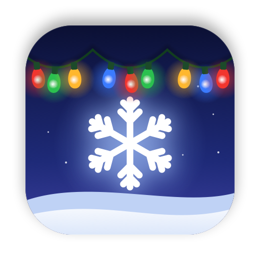

<p align="center">
  
</p>

<h1 align="center">SeasonMyMac</h1>

<p align="center">
  Seasonal magic for your Mac's desktop: snow that piles up on your windows and the Dock, and holiday lights strung along the screen.
</p>

<p align="center">
  <a href="https://github.com/pallepadehat/SeasonMyMac/actions/workflows/ci.yml"></a>
  
  
  <a href="LICENSE"></a>
</p>

<!-- Add a screenshot or GIF here: docs/screenshot.png -->

## Features

**Snow**
- Falls over everything, with depth, wind, and flakes that sway.
- Settles on the top edges of your windows and on the Dock, but only where they're actually visible.
- Rides along when you drag a window gently, and flies off with real momentum when you shake it, stop suddenly, or resize it. Snow that falls can pile up again on a window below.
- Brush it away with the pointer, or shake it all off from the menu bar.
- Stays put when you switch Spaces, and comes back with its window.

**Holiday lights**
- A garland clipped along the top of the Dock, scalloping over the icons.
- A garland along the bottom edge of the menu bar.
- Five colour sets (Classic, Warm White, Icy, Candy Cane, Aurora) and four effects (Steady, Twinkle, Chase, Breathe).
- Bulbs swing in the breeze and when you nudge them with the pointer.
- They never block a click.

**Yours to tune**
- Intensity, flake size, fall speed, wind, snow depth, build-up speed and stickiness.
- Bulb size, density, brightness, loop width and droop.
- Hides automatically for full-screen apps, or for apps you choose.
- Live previews in Settings, so you see every change before it hits the desktop.

**Light on resources**
- Metal rendering with a handful of draw calls per frame and no per-frame allocations.
- 30 fps for drifting snow, 60 fps only while something moves fast, and close to nothing when idle.
- Stops completely while hidden, on full-screen Spaces, and while the displays sleep. Respects Low Power Mode.

## Seasons

| Season | Status |
| --- | --- |
| 🎄 Christmas: snow and holiday lights | ✅ Available |
| 🎃 Halloween | 🛠️ Planned |
| 🎆 New Year | 🛠️ Planned |
| Your idea? | [Pitch a season](../../issues/new?template=season_idea.yml) |

## Install

You need a Mac on **macOS 14 or later**. Paste this into Terminal:

```sh
curl -fsSL https://raw.githubusercontent.com/Pallepadehat/SeasonMyMac/main/install.sh | bash
```

It downloads the latest release, puts SeasonMyMac in your Applications folder (replacing an older copy), and opens it. Run the same command again to update.

SeasonMyMac lives in the menu bar (look for the ❄︎). To have snow and lights line up with the Dock exactly, allow it under **System Settings → Privacy & Security → Accessibility** when asked. Without access, the Dock's size is estimated.

<details>
<summary><b>Or use the .dmg</b></summary>
<br>

Download **SeasonMyMac.dmg** from the [latest release](https://github.com/Pallepadehat/SeasonMyMac/releases/latest), open it and drag SeasonMyMac into Applications.

Releases aren't notarized by Apple yet, so the first time, macOS says it can't check SeasonMyMac for malware. Click **Done**, then open **System Settings → Privacy & Security**, scroll down and click **Open Anyway**. Or run:

```sh
xattr -dr com.apple.quarantine /Applications/SeasonMyMac.app
```

The install script does this for you. It's [short and readable](install.sh), if you'd like to check it first.

</details>

<details>
<summary><b>Uninstall</b></summary>
<br>

Quit SeasonMyMac from its menu, then:

```sh
rm -rf /Applications/SeasonMyMac.app
defaults delete com.pallepadehat.SeasonMyMac
```

</details>

### Build it yourself

You need **Xcode 27 or later**.

```sh
git clone https://github.com/Pallepadehat/SeasonMyMac.git
cd SeasonMyMac
open SeasonMyMac.xcodeproj    # then press ⌘R
```

If Xcode asks for the Metal Toolchain, install it, or run `xcodebuild -downloadComponent MetalToolchain`. Or build from the command line with `./scripts/build.sh`.

Builds work without an Apple developer team. To sign with yours, copy `Config/Local.xcconfig.example` to `Config/Local.xcconfig` and add your team ID. That file is git-ignored.

## Privacy

SeasonMyMac reads only the **positions** of on-screen windows, never their contents or titles. It needs no Screen Recording permission, collects nothing, and makes no network requests. Accessibility access is used only to read the Dock's size.

The app isn't sandboxed, because the sandbox doesn't allow reading other apps' window positions or using Accessibility.

## How it's built

| Folder | What's inside |
| --- | --- |
| [`Packages/SeasonKit`](Packages/SeasonKit) | The simulation: snow (`SnowWorld`, `SnowPile`), surfaces, and light strings. Pure Swift, no AppKit or Metal, fully unit tested. |
| [`SeasonMyMac/App`](SeasonMyMac/App) | The app entry point and `AppModel`, which owns the settings. |
| [`SeasonMyMac/Settings`](SeasonMyMac/Settings) | The settings model, its storage, and the Settings window with its live previews. |
| [`SeasonMyMac/MenuBar`](SeasonMyMac/MenuBar) | The menu bar panel. |
| [`SeasonMyMac/Overlay`](SeasonMyMac/Overlay) | One transparent, click-through window per display, and `SeasonView`, which runs every frame. |
| [`SeasonMyMac/Desktop`](SeasonMyMac/Desktop) | Reads windows, the Dock and the pointer, and converts between coordinate spaces. |
| [`SeasonMyMac/Rendering`](SeasonMyMac/Rendering) | The Metal renderer and shaders. |
| [`scripts`](scripts) | Building, packaging and releasing, plus `generate-icon.swift`, which draws the app icon and logo. |
| [`install.sh`](install.sh) | The one-command installer. |

## Contributing

Contributions are very welcome, especially new seasons! Start with [CONTRIBUTING.md](CONTRIBUTING.md).

## License

[MIT](LICENSE) © 2026 Patrick Jakobsen
